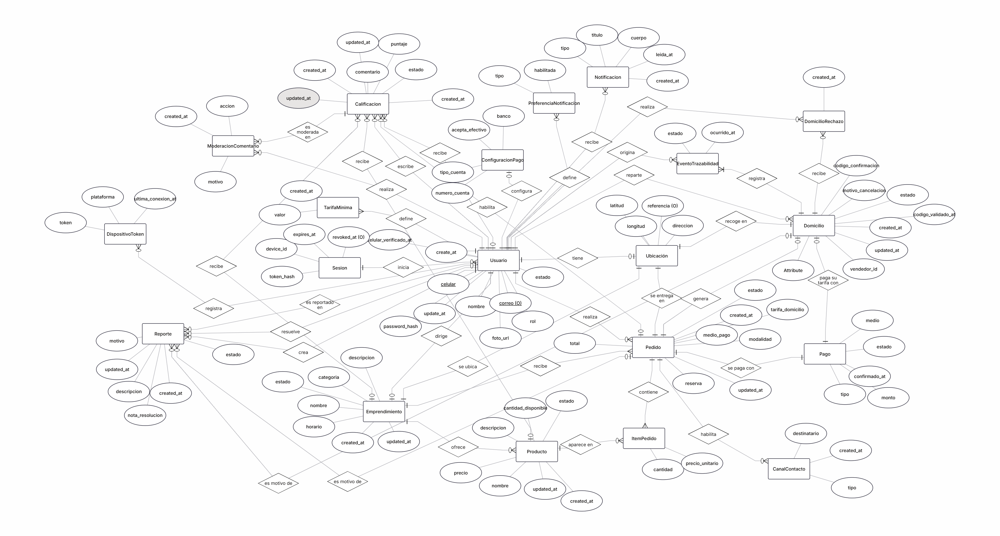
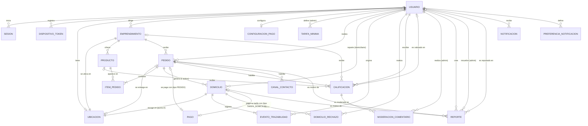

# Spec general de Ñapa

**Updated**: 2026-10-20 **Alcance**: reglas compartidas por todos los requerimientos: roles, convenciones de API, modelo de datos y estados. **Fuentes**: requerimientos/funcionales.md (reglas del dominio), investigacion/HistoriasDeUsuario/historias_de_usuario.md (actores), capstone/informe-capstone.md. El modelo de datos sigue el ER diseñado por el equipo en ERDPlus, que es la fuente de verdad.

> Los planes técnicos (specs/RF-NN-*/plan.md) **no redefinen** el modelo de datos ni las convenciones: las referencian. Si una feature necesita un cambio de esquema, se corrige primero este documento.

## 1. Roles y actores

| Término del dominio | Rol en el sistema (usuario.rol) | Descripción |
| ------ | ------ | ------ |
| **Comprador**  (en las specs:  *Cliente* ) | CLIENTE | Descubre emprendimientos, hace pedidos, paga, califica. |
| **Vendedor**   *(abstracto)* | VENDEDOR_AMBULANTE o VENDEDOR_PUNTO_FIJO | Administra su emprendimiento y productos y atiende pedidos. El tipo se elige al crear la cuenta y vive solo en usuario.rol. |
| Vendedor ambulante | VENDEDOR_AMBULANTE | Entrega directa; no ofrece recogida ni domicilio. |
| Vendedor de punto fijo | VENDEDOR_PUNTO_FIJO | Recogida en el punto y domicilio mediante domiciliarios. |
| **Domiciliario** | DOMICILIARIO | Lleva pedidos del punto A al punto B; acepta la tarifa publicada o rechaza. |
| **Administrador** | ADMINISTRADOR | Supervisa usuarios, domicilios, pagos, comentarios y reportes. |
| Usuario | (actor base) | Funciones comunes: cuenta y notificaciones. |

**Pedidos: quién interviene.** El *comprador* crea el pedido y lo consulta (RF-45, RF-47, RF-48, RF-49). El *vendedor* lo lista, ve el detalle, consulta al comprador y lo acepta o rechaza (RF-50 a RF-53). Las modalidades por tipo de vendedor están en funcionales.md (Reglas generales) y en el informe. La **reserva** es un atributo del pedido, no una modalidad.  **El receptor de un pedido es siempre el cliente que lo hace**; si lo recibe otra persona, se resuelve con la dirección de entrega.

> En el código y la API se mantiene CLIENTE/cliente. "Comprador" es el nombre del rol en los documentos de diseño.

### 2. Convenciones de API

Prefijo /api/v1. JSON en UTF-8. Fechas ISO-8601 UTC. Enumeraciones en MAYÚSCULAS. Dinero en pesos colombianos como entero (tarifa_domicilio, total, monto).

#### 2.1 Acciones de estado e Idempotencia

*   **Acciones de estado**: Toda acción que cambia el estado de un recurso es `POST /api/v1/{recurso}/{id}/{accion}` (verbo en infinitivo, minúsculas, sin tildes). No se usa `PATCH` para transiciones de estado.
*   **Idempotency-Key**:
    *   Obligatoria en todo `POST` autenticado que cambie estado o dinero.
    *   Clave en Redis: `idem:{userId}:{key}`. En endpoints sin sesión que la exijan (registro) se usa `idem:{deviceId}:{key}` con `X-Device-Id`.
    *   **Exentos** (propuesta, a confirmar): `POST /auth/login`, `POST /auth/refresh`, `POST /auth/logout`, las solicitudes de OTP (ya limitadas por rate-limit) y `POST /dispositivos` (único por `(usuario, token)` en BD).

#### 2.1.1 Cabeceras 

| Cabecera | Sentido | Cuándo | Contenido |
| ------ | ------ | ------ | ------ |
| Authorization | Request | Todo menos registro, login, verificación y recuperación | Bearer <JWT de acceso> |
| Content-Type | Request | Si hay cuerpo | application/json |
| Accept-Language | Request | Opcional | es-CO (mensajes de error) |
| Idempotency-Key | Request | **Obligatoria** en POST autenticado que cambie estado o dinero | UUID generado en el dispositivo al tocar el botón |
| X-Device-Id | Request | Auth y registro de token push | Identificador estable de instalación |
| X-Request-Id | Request/Response | Opcional en request; siempre en response | Identificador de traza; se repite en traceId del error |
| Location | Response | 201 |URL del recurso creado, solo cuando el recurso tiene un GET propio (no aplica a POST /reportes ni a POST /calificaciones) |
| Idempotent-Replayed: true | Response | Cuando se devuelve una respuesta guardada | Indica repetición, no una nueva operación |
| Retry-After | Response | 429, 503 | Segundos de espera |
| Cache-Control: no-store | Response | Auth, pagos, ubicación, código de confirmación | Evita caché de datos sensibles |

#### 2.2 Códigos HTTP

| Código | Uso | code típico |
| ------ | ------ | ------ |
| 200 | Lectura o acción con cuerpo de respuesta | — |
| 201 | Recurso creado (con Location) | — |
| 202 | Aceptado para procesar de forma asíncrona (p. ej. solicitud de OTP) | — |
| 204 | Éxito sin cuerpo (eliminar, marcar leída) | — |
| 400 | Datos inválidos o cabecera obligatoria ausente | VALIDATION_ERROR |
| 401 | Sin sesión, token vencido o revocado | UNAUTHORIZED, TOKEN_EXPIRED |
| 403 | Rol o pertenencia no permitidos | FORBIDDEN |
| 404 | Recurso inexistente o no visible para el usuario | NOT_FOUND |
| 405 | Método no ofrecido (p. ej. editar un domicilio) | METHOD_NOT_ALLOWED |
| 409 | Conflicto de estado o duplicado | INVALID_STATE, ALREADY_CONFIRMED, CONFLICT, y códigos específicos (PAYMENT_NOT_CONFIRMED, ALREADY_PUBLISHED) |
| 422 | Misma Idempotency-Key con cuerpo distinto; regla de negocio con cuerpo válido | IDEMPOTENCY_KEY_REUSED, BUSINESS_RULE |
| 429 | Límite de intentos (login, OTP, código de entrega) | RATE_LIMITED |
| 500 | Error inesperado | INTERNAL_ERROR |
| 503 | Servicio externo caído (mapas, push, WhatsApp) | EXTERNAL_SERVICE_UNAVAILABLE |

Cuerpo de error: { "code": "...", "message": "mensaje para el usuario", "details": {...}, "traceId": "...", "timestamp": "..." }. INVALID_STATE incluye details.estadoActual.

##### 2.2.1 Catálogo de códigos de error específicos 

| HTTP | code | Uso |
| ------ | ------ | ------ |
| 401 | INVALID_CREDENTIALS | Login fallido (mensaje genérico; también para cuenta ELIMINADA) |
| 403 | ACCOUNT_NOT_VERIFIED | Cuenta PENDIENTE_VERIFICACION |
| 400 | OTP_INVALID | Código incorrecto; details.intentosRestantes |
| 400 | OTP_EXPIRED | Código vencido |
| 409 | OTP_ATTEMPTS_EXHAUSTED | 5 intentos fallidos: pedir código nuevo |
| 409 | PHONE_ALREADY_REGISTERED / EMAIL_ALREADY_REGISTERED | Dato en uso |
| 400 | INVALID_CURRENT_PASSWORD | Contraseña actual incorrecta |
| 400 | PASSWORD_REUSED | Nueva igual a la actual (decisión provisional, ver RF-09) |
| 409 | OUT_OF_STOCK | Inventario insuficiente al crear un pedido inmediato (RF-45) o al aceptarlo (RF-53) |
| 409 | PRODUCT_UNAVAILABLE | Producto agotado en un pedido inmediato |
| 409 | BANK_ACCOUNT_REQUIRED | Domicilio sin cuenta bancaria del vendedor |
| 409 | PAYMENT_NOT_CONFIRMED | Publicar domicilio sin pago confirmado (ya listado) |
| 409 | ALREADY_PUBLISHED | Pedido con domicilio activo (ya listado) |
| 409 | RESERVATION_NOT_DUE | Acción sobre una reserva antes de reserva − margen |
| 409 | NOT_AVAILABLE | Domicilio ya tomado o cancelado |
| 429 | CODE_ATTEMPTS_LOCKED | 5 fallos del código de entrega: bloqueo de 15 min |
| 503 | EXTERNAL_SERVICE_UNAVAILABLE | (existente) mapas, push, WhatsApp |
| 400 | CODE_INVALID | Código de confirmación de entrega incorrecto; details.intentosRestantes (RF-24) |
| 409 | ACTIVE_DELIVERY_EXISTS | El domiciliario ya tiene un domicilio activo (ASIGNADO, RECOGIDO o EN_CAMINO); details.domicilioActivoId (RF-19) |

### 2.3 Paginación, orden y filtros (query parameters)

Todo listado acepta page (desde 0), size (por defecto 20, máximo 100) y sort=campo,asc|desc. Respuesta: { "content": [...], "page": 0, "size": 20, "totalElements": 0 }. Los filtros se envían como query parameters; un filtro desconocido responde 400.

| Endpoint | RF | Filtros |
| ------ | ------ | ------ |
| GET /emprendimientos | RF-31 | tipoVendedor (según usuario.rol del dueño), lat, lng, radioMetros, orden=cercania |
| GET /emprendimientos/{id}/productos | RF-33 | sort |
| GET /productos (del vendedor) | RF-55 | estado (DISPONIBLE, AGOTADO) |
| GET /pedidos (limitado al usuario autenticado) | RF-47, RF-50 | estado, modalidad, reserva (true = con fecha acordada), desde, hasta |
| GET /domicilios | RF-15, RF-12 | estado, desde, hasta; el administrador añade vendedorId, domiciliarioId |
| GET /domicilios/disponibles | RF-16 | orden=cercania\|ganancia, lat, lng |
| GET /pagos | RF-40, RF-41 | medio, estado, tipo, desde, hasta |
| GET /calificaciones | RF-02, RF-03 | tipoEntidad (EMPRENDIMIENTO, PRODUCTO, USUARIO), entidadId; se traducen a la relación de destino de la calificación |
| GET /notificaciones | RF-38 | leida |
| GET /reportes | RF-61 | estado |
| GET /usuarios | RF-69 | rol, estado |

### 2.4 Catálogo de rutas (planes P1) 

Prefijo `/api/v1`. "Idem" = exige `Idempotency-Key`.

| RF | Método y ruta | Rol | Idem |
| ------ | ------ | ------ | ------ |
| RF-07 | POST /auth/register | público | ✅ (por device) |
| RF-70 | POST /auth/verify-phone/request (reenvío / canal SMS) · POST /auth/verify-phone/confirm · GET /auth/verify-phone/mensajes/{mensajeId} · POST /webhooks/twilio/status | público / Twilio | — |
| RF-10 | POST /auth/login · POST /auth/refresh · POST /auth/logout | público / autenticado | — |
| RF-09 | POST /auth/password/change · POST /auth/password/recover/request · POST /auth/password/recover/confirm | autenticado / público | ✅ en change y confirm |
| RF-08 | PATCH /usuarios/me · POST /usuarios/me/celular/solicitar-cambio · POST /usuarios/me/celular/confirmar | autenticado | ✅ en los POST |
| RF-38 | GET /notificaciones · POST /notificaciones/{id}/leer · POST /dispositivos | autenticado | — |
| RF-28 | POST /emprendimientos | vendedor | ✅ |
| RF-31 | GET /emprendimientos | cliente | — |
| RF-32 | GET /emprendimientos/{id} | cliente | — |
| RF-54 / RF-55 | POST /productos · GET /productos | vendedor | ✅ en POST |
| RF-57 | POST /productos/{id}/inventario (fija la cantidad) | vendedor | ✅ |
| RF-63 | PUT /vendedores/me/configuracion-pago | vendedor | — |
| RF-45 | POST /pedidos | cliente | ✅ |
| RF-48 | GET /pedidos/{id} | cliente | — |
| RF-50 / RF-51 | GET /pedidos · GET /pedidos/{id} | vendedor | — |
| RF-53 | POST /pedidos/{id}/aceptar · POST /pedidos/{id}/rechazar | vendedor | ✅ |
| RF-35 | GET /pedidos/{id}/ubicacion-entrega | vendedor ambulante | — |
| RF-36 | POST /pedidos/{id}/iniciar-entrega | vendedor ambulante | ✅ |
| RF-37 | POST /pedidos/{id}/confirmar-entrega | vendedor ambulante | ✅ |
| RF-64 | POST /pedidos/{id}/marcar-listo | vendedor de punto fijo | ✅ |
| RF-65 | POST /pedidos/{id}/confirmar-retiro | vendedor de punto fijo | ✅ |
| RF-42 | POST /pedidos/{id}/pago/confirmar (solo domicilio; en directa y recogida lo hace RF-37/RF-65) | vendedor | ✅ |
| RF-14 | POST /pedidos/{id}/domicilio | vendedor de punto fijo | ✅ |
| RF-16 | GET /domicilios/disponibles | domiciliario | — |
| RF-18 | GET /domicilios/{id} | domiciliario / partes | — |
| RF-19 | POST /domicilios/{id}/aceptar | domiciliario | ✅ |
| RF-22 | GET /domicilios/{id}/ruta | domiciliario asignado | — |
| RF-23 | POST /domicilios/{id}/confirmar-recogida · POST /domicilios/{id}/confirmar-salida | domiciliario / vendedor | ✅ |
| RF-24 | POST /domicilios/{id}/confirmar-entrega (cuerpo: codigo) | domiciliario | ✅ |
| RF-25 | GET /domicilios/{id}/codigo-confirmacion | cliente | — |
| RF-26 | GET /domicilios/{id}/trazabilidad · PUT /domicilios/{id}/ubicacion-domiciliario | cliente / vendedor · domiciliario | — |
| RF-60 | POST /reportes | cliente / vendedor / domiciliario | ✅ |
| RF-01 | POST /calificaciones | cliente / vendedor / domiciliario | ✅ |
| RF-02 | GET /calificaciones | todos | — |
| RF-06 | GET /calificaciones (admin) · POST /calificaciones/{id}/eliminar-moderacion · PATCH /calificaciones/{id}/moderar-texto | administrador | ✅ en POST |
| RF-63 | GET /vendedores/me/configuracion-pago | vendedor | — |
| RF-44 | POST /tarifa-minima | administrador | ✅ |
| RF-44 | GET /tarifa-minima | administrador | — |
| RF-45 | POST /pedidos/cotizacion | cliente | — |

## 3. Modelo de datos

El diagrama de ERDPlus es la fuente de verdad. Esta sección lo transcribe. Convenciones: id uuid; dinero bigint en pesos; los estados y valores fijos (rol, estado, modalidad, medio, tipo) son **atributos enumerados**, no entidades. Todas las tablas llevan created_at y updated_at (RNF16), salvo las indicadas en cada entidad.

### 3.1 Diagrama entidad-relación

El diagrama Mermaid muestra las relaciones;

#### 3.2 Entidades

**Usuario** — id, nombre, celular (único; opcional solo para ADMINISTRADOR), correo (único; obligatorio para ADMINISTRADOR, opcional para otros), password_hash, foto_url (opcional), rol (CLIENTE, VENDEDOR_AMBULANTE, VENDEDOR_PUNTO_FIJO, DOMICILIARIO, ADMINISTRADOR), estado (PENDIENTE_VERIFICACION, ACTIVA, ELIMINADA), celular_verificado_at, created_at (fecha de registro), updated_at. Restricción CHECK por rol. El administrador inicia sesión con correo y contraseña, y se siembra desde la BD. No existe entidad Cuenta. session_version es solo una nota de implementación. **Ubicacion** — id, latitud, longitud, direccion, referencia (opcional). Cada uso crea su propia fila (no se comparte). La usan: Usuario (0..1), Emprendimiento (1:1), Pedido (0..1; no aplica en RECOGIDA) y Domicilio solo para el punto A (1:1). La columna geography(Point,4326) es detalle de implementación derivado de latitud y longitud.  **Sesion** — id, token_hash, device_id, created_at, expires_at, revoked_at (opcional). Usuario inicia Sesion (1:N). "Activa" se deduce de revoked_at y expires_at.  **DispositivoToken** — id, token (FCM), plataforma (ANDROID, IOS), ultima_conexion_at. Usuario registra DispositivoToken (1:N); único (usuario, token). Independiente de Sesion.device_id.  **Emprendimiento** — id, nombre, categoria (enumerado: FRUTAS_VERDURAS, PESCADO_MARISCOS, ALIMENTOS_PREPARADOS, BEBIDAS, SNACKS, OTROS), descripcion, hora_apertura y hora_cierre (hora local, time; reemplazan horario; único rango diario que puede cruzar la medianoche), estado (ACTIVO, INACTIVO, ELIMINADO). Sin tipo_vendedor (sale de Usuario.rol). Usuario dirige Emprendimiento (1:N); solo uno ACTIVO por usuario (índice único parcial). Se ubica en una Ubicacion (1:1).  **Producto** — id, nombre (único por emprendimiento entre productos no ELIMINADO), descripcion, unidad (UNIDAD, KG, LIBRA, LITRO, PORCION), precio (> 0), cantidad_disponible (numeric(10,2), ≥ 0), estado (DISPONIBLE, AGOTADO, ELIMINADO). Emprendimiento ofrece Producto (1:N); cada producto pertenece a un solo emprendimiento. Sin foto.  **Pedido** — id, modalidad (ENTREGA_DIRECTA, RECOGIDA, DOMICILIO), estado, reserva (fecha y hora acordadas; nulo = pedido inmediato), medio_pago (medio real con el que paga el cliente, elegido entre los habilitados por el vendedor; Pago.medio lo copia al crearse), tarifa_domicilio (solo DOMICILIO; calculada al pedir con piso de la tarifa mínima; el Domicilio no la repite), total (valor congelado). Sin subtotal (derivado) ni receptor_* (el receptor es el cliente). Relaciones: Usuario realiza Pedido (1:N); Emprendimiento recibe Pedido (1:N); Pedido se entrega en Ubicacion (0..1); contiene ItemPedido (1:N); genera Domicilio (0..N, uno activo); se paga con Pago (0..1 de tipo PEDIDO); habilita Calificacion (1:N) y CanalContacto (1:N).  **ItemPedido** — id, cantidad, precio_unitario (copia al comprar). El nombre se obtiene del Producto. Pedido contiene ItemPedido; Producto aparece en ItemPedido (1:N).  **ConfiguracionPago** — id, acepta_efectivo, banco, numero_cuenta, tipo_cuenta (los tres últimos opcionales y van juntos). Usuario configura ConfiguracionPago (0..1). Limitación conocida: al ser editable no conserva la cuenta con la que se publicó un domicilio en curso (RF-63).  **Pago** — id, tipo (PEDIDO, TARIFA_DOMICILIO), monto, medio (EFECTIVO, CUENTA_BANCARIA; la tarifa siempre CUENTA_BANCARIA), estado (PENDIENTE_CONFIRMACION, REGISTRADO, CONFIRMADO), confirmado_at. La fila de pago se crea en PENDIENTE_CONFIRMACION cuando el vendedor **acepta** el pedido (RF-53), con monto = total y medio = Pedido.medio_pago (CUENTA_BANCARIA en domicilio). Relaciones 1:1 opcionales con Pedido (tipo PEDIDO) y con Domicilio (tipo TARIFA_DOMICILIO); la regla "de un pedido o de un domicilio, nunca ambos ni ninguno". No guarda quién registra ni quién confirma: se deduce. En el pago del pedido, el vendedor es el dueño del emprendimiento del pedido; en el pago de la tarifa, registra el vendedor del pedido del domicilio y confirma el domiciliario que reparte ese domicilio (que no se reasigna). confirmado_at conserva cuándo se confirmó.  **TarifaMinima** — id, valor (> 0), created_at. Cada cambio es una fila nueva; la vigente es la última y el valor anterior de cada cambio es el valor de la fila previa (RF-44 FR-005). Sin relación con Pedido ni Domicilio. Usuario (administrador) define TarifaMinima (opcional del lado de TarifaMinima). La mínima por defecto del primer despliegue es un **parámetro de configuración** (RF-44 FR-006): mientras no haya filas, rige ese parámetro.  **Domicilio** — id, estado, codigo_confirmacion, motivo_cancelacion (opcional). Sin tarifa, sin receptor_*, sin vendedor_id, sin punto B (se lee de la ubicación de entrega del Pedido, inmutable),
sin codigo_validado_at ni llegada_confirmada_at (la fecha de la entrega queda en el EventoTrazabilidad de ENTREGADO, con el domiciliario como autor). version es una nota de implementación. Relaciones: Pedido genera Domicilio (uno activo; único parcial donde estado <> 'CANCELADO'); recoge en Ubicacion (punto A, copia del punto fijo al publicar); Usuario (domiciliario) reparte Domicilio (0..1); registra EventoTrazabilidad (1:N, mínimo 1); recibe DomicilioRechazo (1:N); paga su tarifa con Pago (0..1). Inmutables tras publicar: pedido y punto A. **Código de confirmación**: se genera al asignar (RF-19), solo lo ve el cliente (RF-25) y el domiciliario lo ingresa al entregar (RF-24); es la única confirmación de la entrega. Se guarda tal cual (6 dígitos aleatorios generados al asignar) y deja de servir al entregarse o cancelarse el domicilio.  **EventoTrazabilidad** — id, estado, ocurrido_at. Inmutable, sin updated_at. Domicilio registra EventoTrazabilidad (1:N); Usuario origina EventoTrazabilidad (1:N). El caso de uso lo inserta en la misma transacción que el cambio de estado.  **DomicilioRechazo** — created_at. Entidad débil con PK compuesta (domiciliario, domicilio). Usuario realiza / Domicilio recibe, ambas identificadoras. Irreversible y no consultable desde la app; solo filtra la lista de disponibles (RF-16 FR-003).  **Calificacion** — id, puntaje entero 1–5 obligatorio, comentario opcional (máximo 300 caracteres), estado (ACTIVA, ELIMINADA_AUTOR, ELIMINADA_MODERACION). Tres relaciones opcionales de destino (Emprendimiento recibe, Producto recibe, Usuario es valorado en); exactamente una por calificación. Usuario escribe Calificacion (obligatoria). Pedido habilita Calificacion (obligatoria; el domicilio se deduce del pedido). Único (autor, pedido, destino). El promedio es derivado, no se guarda.  **ModeracionComentario** — id, accion (EDITADO, ELIMINADO), contenido_anterior (texto del comentario antes de la acción, para auditoría), created_at. El administrador solo edita el texto del comentario; el puntaje no se modifica. Calificacion es moderada en ModeracionComentario (1:N); Usuario (administrador) realiza ModeracionComentario (1:N). Sin updated_at.  **Reporte** — id, motivo, descripcion, estado (PENDIENTE, EN_REVISION, RESUELTO), nota_resolucion. Sin rol_autor (sale del autor) ni entidad_tipo/entidad_id. Usuario crea (obligatoria); Usuario (administrador) resuelve (opcional); tres relaciones opcionales: Pedido, Domicilio, Usuario reportado (como máximo una; puede no haber ninguna).  **Notificacion** — id, tipo, titulo, cuerpo, leida_at, created_at. Sin event_id (la idempotencia es detalle de implementación). Usuario recibe Notificacion (1:N).  **PreferenciaNotificacion** — tipo, habilitada. Entidad débil con PK (usuario, tipo). Usuario define PreferenciaNotificacion (identificadora).  **CanalContacto** (RF-49 FR-004) — id, tipo (MENSAJE, LLAMADA), destinatario (VENDEDOR, DOMICILIARIO), created_at. Pedido habilita CanalContacto (1:N). No guarda contenido de conversaciones.

**Parámetros de configuración (no son tablas)**: `tarifa.base`, `tarifa.valor_por_km`, `tarifa.valor_por_min`, `tarifa.factor_linea_recta` (respaldo), `tarifa.minima_defecto` (RF-44 FR-006), `reserva.margen_minutos = 15`. Los valores en pesos y el factor los define el equipo.

**Infraestructura, no modelada en el ER:** los índices de rendimiento (p. ej. GiST sobre la ubicación) se definen en las migraciones de cada plan; mensaje (registro de envíos OTP por Twilio, sin el código), outbox_event, y los datos efímeros en Redis (verif-rl:*, verif-att:*, idem:*, sv:*, loc:{domicilioId}, intentos de código de entrega, caché de rutas). El código OTP lo genera y valida el proveedor; Ñapa solo guarda contadores.

#### 3.3 Restricciones que no se dibujan

| # | Restricción |
| ------ | ------ |
| 1 | Solo un usuario con rol vendedor dirige un Emprendimiento y tiene ConfiguracionPago; solo uno ACTIVO por vendedor. |
| 2 | Un pago es de un pedido o de un domicilio, nunca ambos ni ninguno; un solo pago PEDIDO por pedido y un solo pago TARIFA_DOMICILIO por domicilio. |
| 3 | Quién registra y quién confirma un pago no se guarda: en el pago del pedido confirma el vendedor dueño del emprendimiento; en el pago de la tarifa registra el vendedor del pedido y confirma el domiciliario asignado al domicilio. El caso de uso valida esa pertenencia. |
| 4 | Una calificación apunta a un solo destino; única por (autor, pedido, destino). |
| 5 | Un reporte apunta a como máximo una entidad. |
| 6 | Un domicilio solo se publica con pedido DOMICILIO, ACEPTADO y pago PEDIDO CONFIRMADO; un solo domicilio activo por pedido. |
| 7 | Un pedido de domicilio no admite pago en efectivo; el vendedor necesita cuenta bancaria registrada para aceptarlo. |
| 8 | Calificar exige pedido ENTREGADO (RF-01 FR-005). |
| 9 | El código de confirmación solo lo ve el cliente del pedido; solo puede validarse una vez (RF-24 FR-004) y solo con el domicilio EN_CAMINO; máximo 5 intentos fallidos y luego bloqueo temporal de 15 minutos (429). |
| 10 | Al validarse el código correctamente, el domicilio y el pedido pasan a ENTREGADO en la misma transacción. No existe una segunda confirmación del cliente. |
| 11 | El pago de la tarifa al domiciliario solo se registra con el domicilio ENTREGADO (RF-43). |
| 12 | El administrador cancela un domicilio en cualquier estado salvo ENTREGADO (RF-13); al cancelarlo, el pedido asociado pasa a CANCELADO en la misma transacción. |
| 13 | El destino (punto B) de un domicilio es la ubicación de entrega del pedido; el receptor es el cliente. |
| 14 | Un pedido marcado como reserva no descuenta inventario al aceptarse ni al atenderse: el vendedor gestiona su inventario. |
| 15 | Un producto AGOTADO solo puede incluirse en un pedido marcado como reserva. |
| 16 | La modalidad DOMICILIO solo se ofrece al cliente si el vendedor de punto fijo tiene cuenta bancaria registrada. |
| 17 | Las acciones de una reserva (iniciar entrega, marcar listo, publicar domicilio) solo se permiten desde reserva − margen (15 min). |
| 18 | El administrador no verifica celular; su cuenta se siembra y no se registra por la API. |
| 19 | Un domiciliario solo puede tener un domicilio activo (ASIGNADO, RECOGIDO o EN_CAMINO) a la vez: índice único parcial sobre domiciliario_id; aceptar otro responde 409 ACTIVE_DELIVERY_EXISTS (RF-19). |
| 20 | Un reporte sobre un usuario solo es válido si el autor y el reportado compartieron al menos un pedido (RF-60). |
| 21 | Cada rol solo puede calificar ciertos destinos de un pedido ENTREGADO: cliente → emprendimiento, productos y domiciliario; vendedor → cliente y (punto fijo) domiciliario; domiciliario → emprendimiento y cliente (RF-01). |

### 3.4 Tarifa del domicilio (RF-45 FR-006)

`tarifa = max(tarifa_minima_vigente, redondeo_a_100(tarifa.base + km_ruta × tarifa.valor_por_km + min_ruta × tarifa.valor_por_min))`

Distancia y duración vienen de `RoutingPort` (ruta A→B). Si el servicio falla o supera la cuota, se usa el respaldo: `km = distancia_linea_recta × tarifa.factor_linea_recta` y sin componente de tiempo. La tarifa se calcula al hacer el pedido y se congela en `Pedido.tarifa_domicilio`.

## 4. Estados

*   **Pedido**: PENDIENTE, ACEPTADO, RECHAZADO, LISTO_PARA_RECOGER, EN_CAMINO, ENTREGADO, CANCELADO.
    *  Entrega directa: PENDIENTE → ACEPTADO → EN_CAMINO → ENTREGADO.
    *  Recogida: PENDIENTE → ACEPTADO → LISTO_PARA_RECOGER → ENTREGADO.
    *  Domicilio: permanece ACEPTADO mientras el domicilio avanza; pasa a ENTREGADO cuando el domiciliario valida el código del cliente; pasa a CANCELADO si el administrador cancela el domicilio.
    *  Cualquier modalidad puede terminar en RECHAZADO desde PENDIENTE.
*   **Domicilio**: DISPONIBLE → ASIGNADO → RECOGIDO → EN_CAMINO → ENTREGADO, o CANCELADO desde cualquier estado salvo ENTREGADO (RF-13). Las transiciones inválidas responden INVALID_STATE (RNF23).
    *   **Confirmación de la entrega por código**: al llegar, el cliente le dice al domiciliario su código; el domiciliario lo ingresa (RF-24). Si es correcto, en la misma transacción el domicilio y el pedido pasan a ENTREGADO, se inserta el EventoTrazabilidad (domiciliario como autor) y se avisa al vendedor, que debe pagar la tarifa.
    *  Si el cliente no da el código o dice no haber recibido, el domicilio no avanza y sigue EN_CAMINO; el cliente puede crear un reporte (RF-60) y el administrador puede cancelar el domicilio (RF-13).
*   **Pago**: PENDIENTE_CONFIRMACION → CONFIRMADO; la tarifa al domiciliario pasa por REGISTRADO (RF-43), que solo se habilita con el domicilio ENTREGADO.
*   **Reporte**: PENDIENTE → EN_REVISION → RESUELTO.
*   **Calificaciones**: se habilitan con el pedido ENTREGADO; el autor puede editar su calificación (RF-04) o eliminarla (RF-05, estado ELIMINADA_AUTOR); el administrador la modera (RF-06).

#### Puntos abiertos

*  Si el cliente nunca da el código, el domicilio queda EN_CAMINO y el domiciliario no cobra (sin vencimiento automático en el MVP).
*  Código de confirmación: Resuelto en D13 (se guarda en claro en `codigo_confirmacion`).
*  Resuelto: un domiciliario solo puede atender un domicilio a la vez (restricción 19).
*  Vencimientos de pedidos sin respuesta.
*  Si el administrador cancela un domicilio ya pagado, la devolución del dinero ocurre fuera de la plataforma (la plataforma no procesa dinero).

## 5. Eventos
El catálogo completo está en [eventos.md](eventos.md).